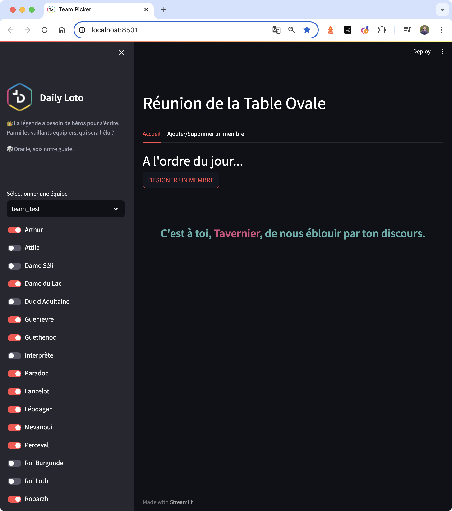

# Team Picker

## 📄 Description

🎲 Discover an application designed to randomly pick a member of your team for various activities or tasks.

🤔 “Who should be the next to speak?” This application helps answer this question by providing a fun and fair way to select a random team member. Whether it's for a meeting, a presentation, or any team activity, let chance decide!

Here's a tool that allows you to manage team members, add or remove members, and perform a random selection with a fun twist. Ideal for teams who want to add an element of surprise and fairness to their processes.

🌐 Access the app and start your random selection now at [https://teampicker.sotisai.com](https://teampicker.sotisai.com).



---

## ⚙️ Setup & Usage

You can run the application in two ways:

- **Locally using `uv`**
- **Using Docker Compose**

### 🔧 Option 1: Run Locally with `uv`

> `uv` is a fast and modern Python tool that handles virtual environments and dependencies via `pyproject.toml`.

1. **Install `uv`** (if not already installed)  
   ```bash
   curl -Ls https://astral.sh/uv/install.sh | sh
   ```

2. **Clone the repository**  
   ```bash
   git clone https://github.com/LudovicGardy/app_name
   cd app_folder/
   ```

3. **Create and activate the environment**  
   ```bash
   uv venv
   ```

   - On **macOS/Linux**:
     ```bash
     source .venv/bin/activate
     ```

   - On **Windows** (PowerShell):
     ```powershell
     .venv\Scripts\Activate.ps1
     ```

4. **(Optional) If the virtual environment doesn't behave properly**

   Sometimes, on macOS in particular, the environment might be missing some tooling (like `pip`). You can try the following fixes:

   ```bash
   .venv/bin/python -m ensurepip --upgrade
   .venv/bin/python -m pip install --upgrade pip
   # Optional: Only if you need to use Jupyter notebooks
   .venv/bin/python -m pip install ipykernel -U --force-reinstall
   ```

5. **Launch the app**  
   ```bash
   streamlit run main.py
   ```

### 🐳 Option 2: Run with Docker

1. **Make sure Docker Desktop is running**

2. **Create the `.env`** from the template and fill in the values: `cp .env.example .env`

3. **Build and start the app**, from the project directory
   ```bash
   ./start-app.sh   # builds the image, starts compose.yaml, waits for the container, prints the URL
   ```

4. **Access the app**
   Open your browser at: [http://localhost:10530](http://localhost:10530)

4. **Stop the app**
   ```bash
   ./stop-app.sh
   ```

`start-app.sh` and `stop-app.sh` are shared by every Docker app of `Apps/`: they are edited
in `apps_django/sotis_pj_template` only, then copied here (`Apps/CLAUDE.md`).

---

## 🚀 Production

Every push to `main` runs `.github/workflows/deploy.yml`: GitHub Actions builds the image,
pushes it to `ghcr.io/ludovicgardy/app_teampicker:<sha>`, then runs
`deploy teampicker prod <sha>` on the VPS over a restricted SSH key.

- `compose.prod.yaml`: the production service (Streamlit on 8080 behind Caddy, no host port).
- `.env.prod.sops`: production secrets, encrypted with sops + age (variable names in
  `.env.prod.sops.example`). Edit with `sops edit --input-type dotenv --output-type dotenv .env.prod.sops`.
- The image installs the versions pinned in `uv.lock`: run `uv lock` after changing a dependency.
- Roll back to the previous release on the VPS: `/opt/infra/bin/rollback.sh teampicker prod`.

---

## 🛠️ Development

### Pre-commit Hooks

This project uses pre-commit to maintain code quality. The following hooks are configured:

- **Basic hooks**: checking for trailing whitespaces, end-of-file formatting, YAML and TOML file verification, etc.
- **Ruff**: Python code linting and formatting
- **Codespell**: spell checking
- **Commitizen**: checking commit messages according to the defined convention

To install pre-commit:

```bash
# Install dependencies
uv pip install pre-commit ruff

# Install git hooks
pre-commit install
```

The hooks will run automatically with each commit. You can also run them manually:

```bash
pre-commit run --all-files  # Run on all files
pre-commit run ruff         # Run a specific hook
```

Ruff configuration is defined in `pyproject.toml` and includes:
- reStructuredText docstring format
- Import checking
- Double quote formatting
- Line length limited to 100 characters

---

## 👤 Author
- LinkedIn: [Ludovic Gardy](https://www.linkedin.com/in/ludovic-gardy/)
- Website: [https://www.sotisai.com](https://www.sotisai.com)
